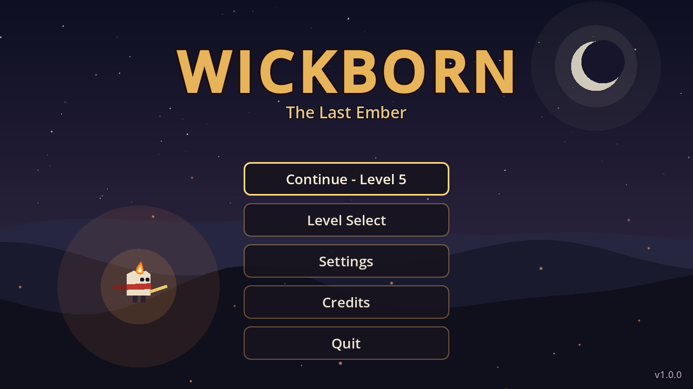
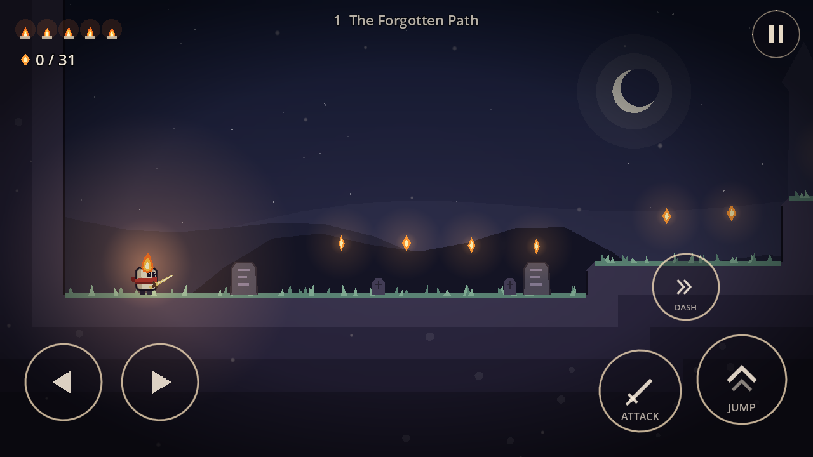
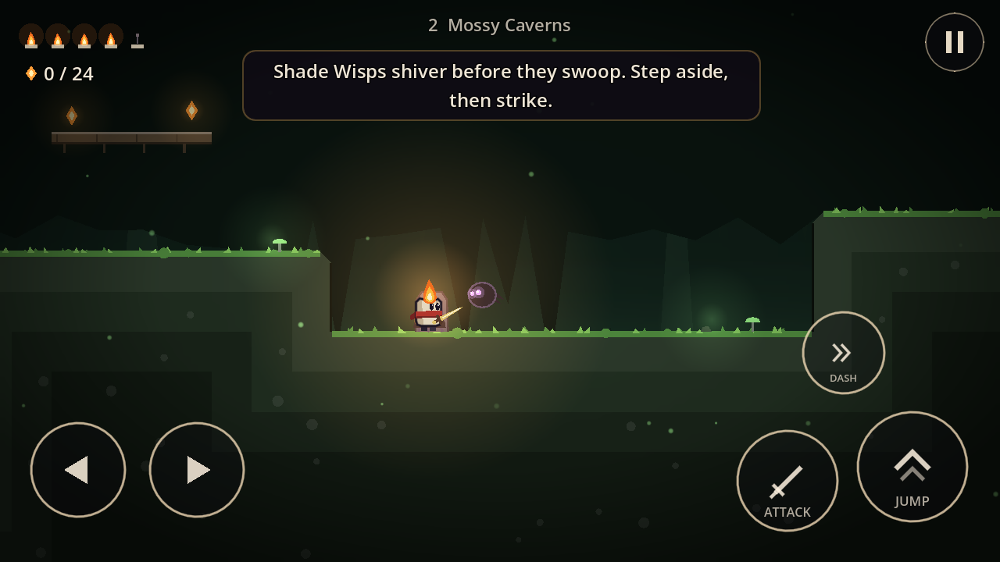
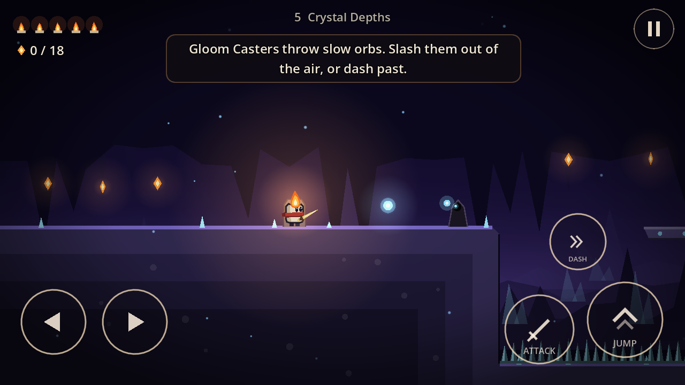
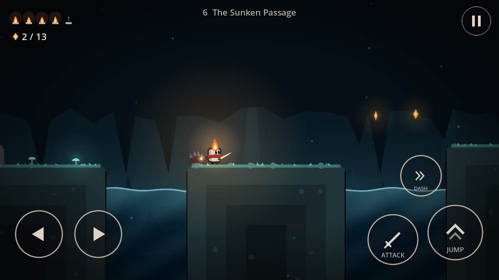
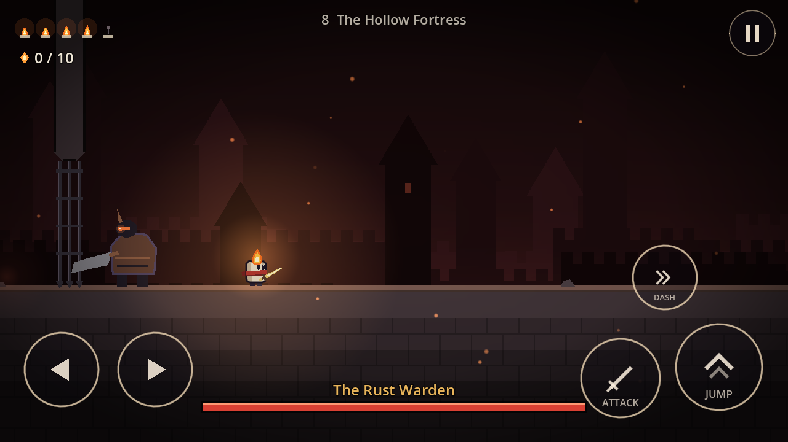
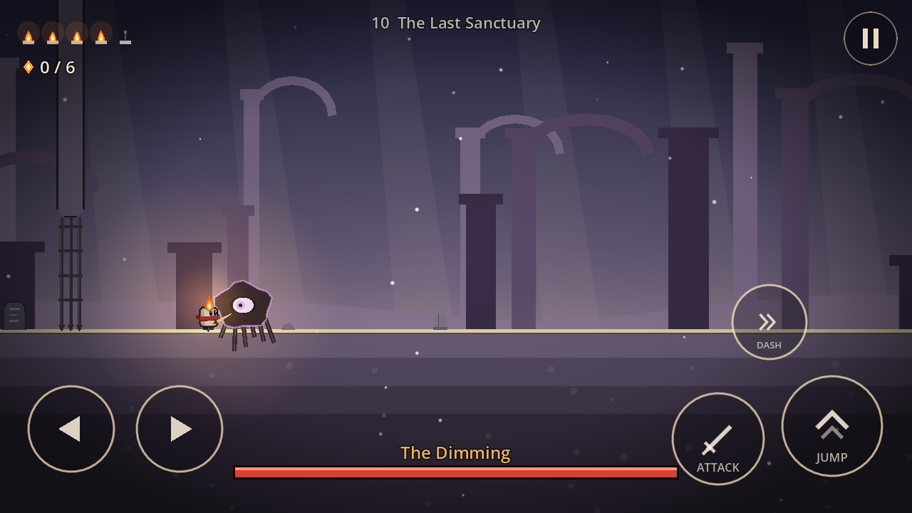

# Wickborn: The Last Ember

A 2D action-platformer for Android, made with **Godot 4.7**. You play Wick, a small candle-spirit
knight. The flame on its head is its health. The world of Cindral is going dark, and Wick has to
cross ten regions to reach the Last Sanctuary and relight the Flame.



| | |
|---|---|
|  |  |
|  |  |
|  |  |

## Download

Get the APK from the [Releases](../../releases) page. To install it on your phone, allow
"Install unknown apps" for your browser or file manager, then open the APK. The game runs fully
offline and needs Android 7.0 (API 24) or newer.

## What's in the game

- **10 levels** (3-6 minutes each): The Forgotten Path (tutorial), Mossy Caverns, The Abandoned
  Village, Whispering Woods (a vertical climb), Crystal Depths, The Sunken Passage, The Shadowed
  Ruins, The Hollow Fortress, The Forgotten Throne and The Last Sanctuary.
- **Combat:** a horizontal sword combo with knockback, hit-stop and screen shake. After taking a
  hit you get knocked back and are briefly invulnerable.
- **Enemies:** Gloomcrawler (small crawler), Shade Wisp (flyer that swoops), Ashen Sentry (melee
  lunge), Gloom Caster (slow orbs you can slash), Stonebound Brute (heavy, shockwave slam).
- **Bosses**, each with 3 attack patterns and a faster second phase:
  - The Rust Warden (mini-boss): charge, leap slam, lunge combo
  - The Ashen King: teleport and orb fan, summons wisps, rows of thorns
  - The Dimming (final boss): orb rain, rolling shockwaves, dive (its eye opens when it lands)
- **Progression:** Ember Dash (level 2), Twin Flame double jump (level 4) and Quickened Blade
  (level 5). Three Heart Wicks each add +1 max health. Each level has one hidden Memory Wick
  that carries a line of lore.
- **Checkpoints:** lanterns heal you and set your respawn point. Spikes, water and pits cost one
  flame and put you back on safe ground.
- **Saving:** level completion, best embers, secrets and upgrades are saved locally.
  Saves are written atomically, so killing the app can't corrupt them.
- **Screens:** main menu, level select, settings, credits, pause, game over, level complete,
  story cards and final victory.
- **Art:** everything is drawn in code from vector shapes (no image assets), with parallax
  silhouettes, additive glow lights, ambient particles and a vignette.
- **Audio:** every sound effect and the 6 music loops (including boss music) are synthesized by
  `tools/gen_audio.gd`. There are no sampled or third-party sounds.

## Controls

| Action | Touch | Keyboard | Gamepad |
|---|---|---|---|
| Move | Left/Right buttons (slide between them) or joystick | A/D, arrows | left stick, D-pad |
| Jump (hold for higher) | JUMP | Space, Z, K | A |
| Attack (hold to repeat) | ATTACK | X, J | X |
| Dash (once unlocked) | DASH | C, L, Shift | B, RB |
| Pause | pause button / Android back | Esc, P | Start |

Touch controls support multitouch, so you can move, jump and attack at the same time.
Under **Settings** you can switch between Left/Right buttons and a fixed or floating joystick,
move the jump button to the left side, change button size and opacity, and adjust stick
sensitivity and deadzone. **Edit control layout** lets you drag every button wherever you like.

## Building

You need:

- Godot **4.7.2** (standard build) plus the Android export templates
- JDK 17 and the Android SDK (platform 35, build-tools 35, platform-tools)
- In *Editor Settings > Export > Android*: the SDK and JDK paths, plus a debug keystore

Debug APK:

```
godot --headless --path . --export-debug "Android" build/wickborn-debug.apk
```

Release APK. The release keystore is **not** in the repo, so pass your own through environment
variables:

```
GODOT_ANDROID_KEYSTORE_RELEASE_PATH=/path/to/release.jks
GODOT_ANDROID_KEYSTORE_RELEASE_USER=<alias>
GODOT_ANDROID_KEYSTORE_RELEASE_PASSWORD=<password>
godot --headless --path . --export-release "Android" build/wickborn.apk
```

The package name is `com.brutalpsychedic.wickborn`. Android only accepts updates signed with
the same key as the installed version, so keep the release keystore safe.

## Tools and tests

All of these run headless:

| Command | What it does |
|---|---|
| `--script res://tools/build_levels.gd` | regenerates `levels/*.txt` from the layouts in code ([format](levels/README.md)) |
| `--script res://tools/validate_levels.gd` | simulates the real jump, double-jump and dash physics to prove every exit, checkpoint and collectible is reachable |
| `--script res://tools/gen_audio.gd` | re-renders all SFX and music into `audio/` |
| `--script res://tools/check_scripts.gd` | compiles every script and reports parse errors |
| `-- --test=smoke` | opens every menu; for each level: builds it, simulates input, tests pause, lights a checkpoint, fights and kills the boss, takes the exit; then checks the ending and victory |
| `-- --test=death` | dies, checks Game Over, retries from the checkpoint |
| `-- --test=physics` | measures jump height and distance |

Developer flags (after `--`): `--level=N`, `--at=X,Y` (spawn at a map cell), `--unlock-all`,
`--touch` (show touch controls on desktop) and `--screen=select|settings|credits|story|victory`.

## Project layout

```
scenes/main.tscn          root scene (screen switching)
scripts/autoload/         Game (input map, settings, save, flow), Audio (SFX pool, music crossfade)
scripts/level/            level parser, builder (collision merging, terrain art), parallax backdrop
scripts/player/           controller + procedural animation
scripts/enemies/          shared enemy base, 5 enemy types, projectiles, shockwaves
scripts/bosses/           shared boss base + the three bosses
scripts/objects/          pickups, checkpoints, exit, signs, hazards, platforms, secret overlays
scripts/ui/               theme kit, touch controls, HUD, menus
levels/                   level data (plain text)
audio/                    generated WAVs (imported as QOA; music loops via WAV loop points)
tools/                    level builder/validator, audio generator, script checker
```

## Performance notes

The project uses the Compatibility (GLES3) renderer. Terrain is drawn once per 16x16 chunk and
then cached, and its collision is merged into large rectangles. Enemies sleep while off-screen.
Lights are additive sprites instead of real 2D lights. The camera runs on the physics tick so the
player and the view stay in step on 90/120 Hz screens.

## Status

- Tested: the scripted play-through above passes headless on Windows. The level validator
  passes for all 10 levels. Frames from every level and boss were rendered and reviewed. Both
  APKs build, are signed, and pass `apksigner verify`.
- Not tested yet: a real Android device. Frame rate on mid-range phones, touch feel and the
  balance numbers all need hands-on playtesting.

## License

No license has been chosen yet. Godot Engine is MIT-licensed (see the credits screen).
